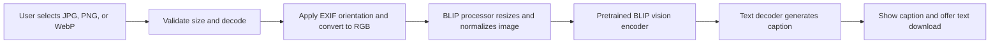

# Processing pipeline

The app keeps the uploaded image in memory and does not write it to disk. On the first run, the pretrained model files download from Hugging Face and are cached by the Transformers library for later runs.
